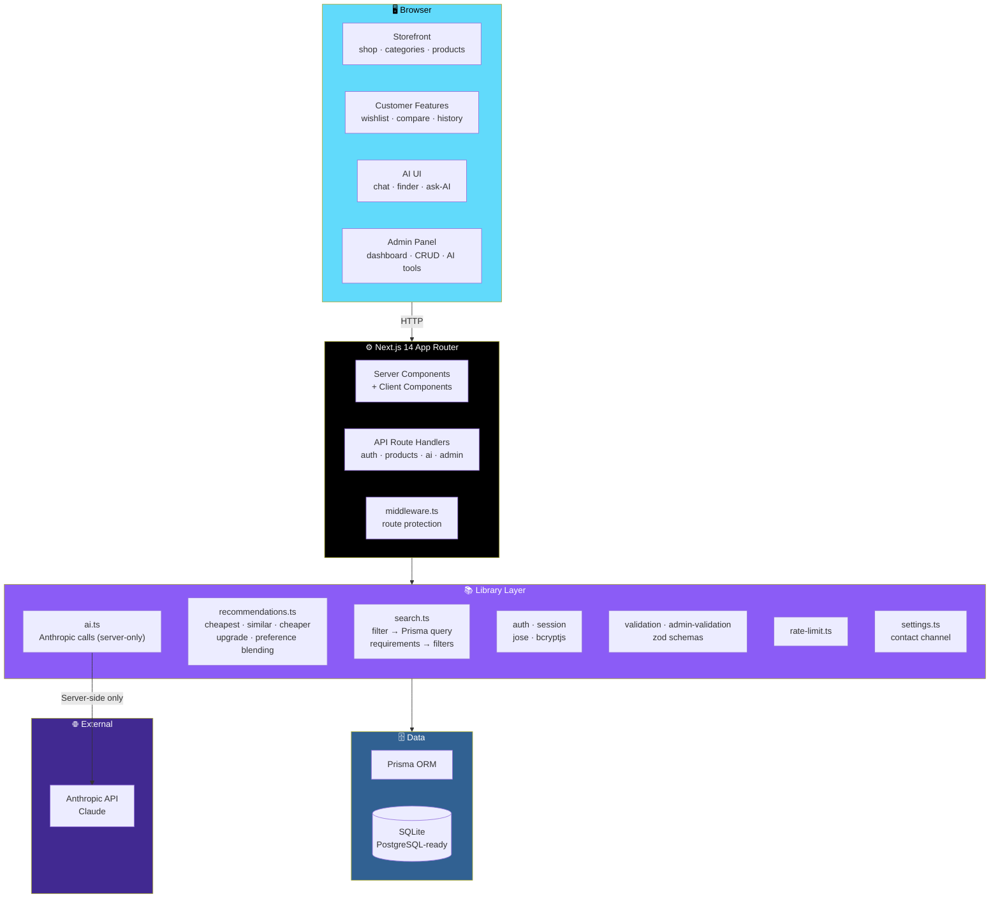
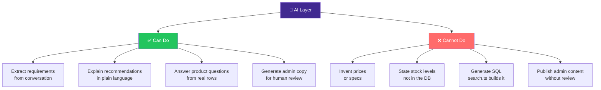

# 🛍️ Aisle — AI Shopping Assistant

<div align="center">


**A modern e-commerce site where AI finds products in your real catalog.**

*Describe what you need in plain language — the assistant extracts requirements, explains recommendations, and never invents product data.*

[✨ Features](#-key-features) • [🏗️ Architecture](#️-architecture) • [📊 Phases](#-whats-built) • [🚀 Getting Started](#-getting-started) • [📝 Notes](#-notes)

</div>

---

## 📖 Overview

**Aisle** is a modern e-commerce site where customers **describe what they need in plain language** — and an AI assistant finds matching products in the store's **real catalog**.

### Core Idea

> **The database is the source of truth.**
>
> Every AI function is given **exact rows from Prisma** and is instructed **never to state a price, spec, or stock level that isn't in them.** The AI extracts requirements, explains recommendations, answers product questions, and generates admin copy — **but never invents product data.**

### 🛠️ Stack

| Layer | Technology |
|-------|-----------|
| **Framework** | Next.js 14 *(App Router)* |
| **UI** | React · TypeScript · Tailwind CSS · shadcn/ui-style components |
| **ORM** | Prisma |
| **Database** | SQLite *(PostgreSQL-ready)* |
| **Auth** | `jose` + `bcryptjs` |
| **Icons** | Lucide |
| **AI** | Anthropic API — **server-side only** |

> 💻 **Running on Windows?** Follow **[RUN.md](./RUN.md)**.

---

## 📊 What's Built

| Phase | Scope | Status |
|:-----:|-------|:------:|
| **1** | Setup, database schema, authentication, dark mode | ✅ **Done** |
| **2** | Product catalog, categories, search, filters, seed data *(~39 products)* | ✅ **Done** |
| **3** | Product details, wishlist, comparison, contact-seller | ✅ **Done** |
| **4** | AI shopping assistant chat + AI Product Finder form | ✅ **Done** |
| **5** | AI recommendations, similar / cheaper / upgrade products, "Ask AI about this product" | ✅ **Done** |
| **6** | Admin dashboard, product / category / brand management, settings | ✅ **Done** |
| **7** | AI product description & tag generation *(admin)* | ✅ **Done** |
| **8** | Analytics *(views / recommendations / searches)*, personalization via saved preferences | ✅ **Done** |

### ⚠️ Status — Please Read

> **This was built and syntax-checked in an offline environment** *(no `npm install`, no dev server, no `npx prisma migrate`)*.
>
> Every file passed:
> - ✅ A **TypeScript parse check**
> - ✅ An **`@/` import-resolution check**
> - ✅ An **export-existence check**
>
> **None of that replaces actually running it.**
>
> **Please work through the checklist in [RUN.md](./RUN.md) and report anything that breaks.**

---

## ✨ Key Features

<div align="center">

| 🗄️ Real Database as Source of Truth | 💬 AI Shopping Assistant |
|:---:|:---:|
| Every AI function is given exact Prisma rows and instructed never to state a price, spec, or stock level that isn't in them | Extracts structured requirements from a conversation · asks clarifying questions · searches the catalog · explains each recommendation |
| **🔍 AI Product Finder** | **🎯 Ask AI About This Product** |
| The same search, as a form — for people who don't want to chat | Per-product AI Q&A grounded in the actual product row |
| **⚖️ AI Comparison** | **🔀 Similar / Cheaper / Upgrade** |
| Side-by-side, grounded in real catalog data | Product suggestions that respect real stock and price |
| **✍️ Admin AI Tools** | **🛒 Full Storefront** |
| Generate description, SEO summary, and tags from a feature list — **admin reviews and edits before saving** | Search · filters · wishlist · comparison · light/dark/system theme · responsive |
| **👑 Admin Panel** | **🛡️ Security** |
| Dashboard with live stats, product/category/brand CRUD, and a configurable contact channel | bcrypt · signed session cookies · two-layer route protection · rate-limited auth and AI · timing-safe login · zod validation on every write |
| **📈 Analytics** | **🎨 Modern UI** |
| Most-viewed · most-recommended · top searches | shadcn/ui-style components · Lucide icons · dark mode |
| **🧠 Personalization** | **📝 Saved Conversations** |
| Blends saved preferences into recommendation scoring | Conversations and recommendations are persisted — viewable at `/history` |

</div>

### Detailed Feature List

#### 🗄️ Real Database as Source of Truth

- Every AI function (`lib/ai.ts`) is given **exact rows from Prisma**
- Every function is instructed **never to state a price, spec, or stock level that isn't in them**
- **Search and filtering** (`lib/search.ts`) build a **typed Prisma query** — the AI **never generates SQL**

#### 💬 AI Shopping Assistant — `/ai-assistant`

- **Extracts structured requirements** from a conversation
- **Asks a clarifying question** when something's missing
- **Searches the catalog**
- **Explains each recommended product**
- **Conversations and recommendations are saved** — viewable at `/history`

#### 🔍 AI Product Finder — `/ai-assistant/finder`

**The same search, as a form** — for people who don't want to chat.

#### 🎯 Ask AI About This Product

Per-product AI Q&A grounded in the actual product row.

#### ⚖️ AI Comparison — `/compare`

Side-by-side comparison grounded in real catalog data.

#### 🔀 Similar / Cheaper / Upgrade Suggestions

Product suggestions that respect real stock and price.

#### ✍️ Admin AI Tools

**Generate from a feature list:**

- Description
- SEO summary
- Tags

> ⚠️ **Admin reviews and edits before saving — nothing publishes automatically.**

#### 🛒 Full Storefront

- **Search**
- **Filters** — category, price, brand, rating, stock, discount
- **Wishlist**
- **Product comparison**
- **Light / dark / system theme**
- **Responsive layout**

#### 👑 Admin Panel

- **Dashboard** with live stats:
  - Most-viewed
  - Most-recommended
  - Top searches
- **Product / category / brand CRUD**
- **Configurable contact channel** — Telegram, phone, Messenger, or contact form

> 💡 **There's no payment/checkout flow, by design.**

#### 🔐 Security

| Protection | Implementation |
|-----------|---------------|
| **Password hashing** | bcrypt |
| **Sessions** | Signed session cookies |
| **Route protection** | **Two layers** — middleware + a fresh database check |
| **Rate limiting** | On auth and AI endpoints |
| **Login timing** | Timing-safe login |
| **Validation** | Zod on every write |

---

## 🏗️ Architecture

### System Overview



### The Grounding Pipeline

```mermaid
flowchart LR
    Request["👤 User asks<br/>in plain language"] --> Extract["🧠 AI extracts<br/>structured requirements"]
    Extract --> Search["🔍 search.ts<br/>builds typed Prisma query"]
    Search --> DB[("🗄️ Database<br/>source of truth")]
    DB --> Rows["📋 Exact product rows"]
    Rows --> AI["🧠 ai.ts<br/>explains recommendations<br/>grounded in those rows"]
    AI --> Answer["💬 Answer + products<br/>no invented data"]

    style Request fill:#61DAFB,color:#000
    style Extract fill:#8B5CF6,color:#fff
    style Search fill:#22C55E,color:#fff
    style DB fill:#316192,color:#fff
    style Rows fill:#FFB454,color:#000
    style AI fill:#412991,color:#fff
    style Answer fill:#0f3460,color:#fff
```



### AI Failure Mode — What It Can and Cannot Do



### Design Principles

<div align="center">

| Principle | Implementation |
|-----------|---------------|
| **🗄️ Database is the source of truth** | Every AI function receives exact Prisma rows and is instructed never to state a price, spec, or stock level that isn't in them |
| **🧠 AI never generates SQL** | Search builds a **typed Prisma query** — the AI only extracts requirements and explains results |
| **✍️ Human review before publish** | Admin AI tools generate — **admin edits and saves** — nothing publishes automatically |
| **🔐 AI stays server-side** | The Anthropic API key is read server-side only and never reaches the browser |
| **🛡️ Two-layer route protection** | `middleware.ts` + a fresh database check on protected routes |
| **✅ Validate every write** | Zod schemas on every write path |
| **📝 Conversations are saved** | The chat is not ephemeral — it's persisted and reviewable |
| **🚫 No checkout, by design** | Contact channel is configured in `/admin/settings` and shown on every product page |

</div>

### Project Structure

```text
app/
  (auth)/login, (auth)/register        Auth pages
  shop, categories, categories/[slug]  Catalog browsing
  products/[slug]                      Product detail
  wishlist, compare, history           Customer features
  ai-assistant, ai-assistant/finder    AI shopping
  admin/*                              Admin panel
  api/*                                Route handlers (auth, products, ai, admin, ...)

components/
  ui/          Buttons, inputs, cards, badges — shared primitives
  auth/        Login/register form, logout button
  layout/      Header, theme provider/toggle
  products/    Product card/grid, filters, search bar, ask-AI panel, contact-seller
  wishlist/    Wishlist button
  compare/     Compare button (localStorage-backed)
  ai/          Chat window
  admin/       Product form, category/brand managers, nav, delete button

lib/
  db, auth, session, validation, admin-validation   Core plumbing
  search.ts        Filter → Prisma query, structured-requirements → filters
  recommendations.ts  Cheapest / best-value / similar / cheaper / upgrade, preference blending
  ai.ts            All calls to the Anthropic API (server-only)
  settings.ts       Site settings (contact channel) stored in the Setting table

prisma/
  schema.prisma, seed.ts, seed-data.json, gen_seed.py (data generator, not run at build time)

middleware.ts   Route protection
```

---

## 🚀 Getting Started

> 💻 **Running on Windows?** Follow **[RUN.md](./RUN.md)** for step-by-step instructions.

### Quick Start

```bash
git clone <repo>
cd ai-shopping-assistant
npm install
cp .env.example .env       # fill in required values
npx prisma migrate dev --name init
npx prisma db seed
npm run dev
```

Open **http://localhost:3000**.

> ⚠️ **Because this was built offline, run the checklist in [RUN.md](./RUN.md) first.** Report anything that breaks.

---

## 📝 Notes

<div align="center">

| Area | Current State | Notes |
|------|--------------|-------|
| **⚡ Rate limiting** | In-memory | Fine for **one server process**. For several instances or serverless, back `lib/rate-limit.ts` with **Redis** |
| **💰 Prices** | Stored as **floats** for simplicity | If you add tax, currency conversion, or payments later, **move to integer cents** |
| **🐘 Moving to PostgreSQL** | Change `provider` to `"postgresql"` in `prisma/schema.prisma`, set `DATABASE_URL`, delete `prisma/migrations`, run `npx prisma migrate dev --name init` | **Enum-like fields are plain strings, so no schema changes are needed** |
| **🖼️ Seed images** | `picsum.photos` placeholders *(need internet to load)* | Replace with real product photo URLs via `/admin/products` or by editing `prisma/gen_seed.py` and reseeding |
| **🧠 AI model** | `claude-sonnet-5` for shopping/recommendation/comparison · `claude-haiku-4-5-20251001` for admin description/tag generation | Change `MODEL` / `FAST_MODEL` in `lib/ai.ts` if you'd rather use different models |
| **🚫 No checkout** | By design | Contact channel is configured in `/admin/settings` and shown on every product page |
| **🧩 shadcn/ui** | `components.json` is included | `npx shadcn@latest add <component>` works for anything not yet in `components/ui` |

</div>

---

## 🗺️ Roadmap

### ✅ Current

- [x] Setup, database schema, authentication, dark mode
- [x] Product catalog, categories, search, filters, seed data *(~39 products)*
- [x] Product details, wishlist, comparison, contact-seller
- [x] AI shopping assistant chat + AI Product Finder form
- [x] AI recommendations, similar / cheaper / upgrade products, "Ask AI about this product"
- [x] Admin dashboard, product / category / brand management, settings
- [x] AI product description & tag generation *(admin)*
- [x] Analytics *(views / recommendations / searches)*
- [x] Personalization via saved preferences
- [x] bcrypt + jose auth with signed session cookies
- [x] Two-layer route protection *(middleware + DB check)*
- [x] Rate-limited auth and AI endpoints
- [x] Timing-safe login
- [x] Zod validation on every write
- [x] shadcn/ui-style design system
- [x] Saved conversations and recommendations at `/history`
- [x] Configurable contact channel *(Telegram, phone, Messenger, contact form)*

### 🔜 Future Ideas

- [ ] **Redis-backed rate limiting** — for multi-instance and serverless deployments
- [ ] **Integer cents** — if payments, tax, or currency conversion arrive
- [ ] **Real product photography** — replacing the `picsum.photos` placeholders
- [ ] **Streaming AI responses** — token-by-token for a more responsive chat
- [ ] **Semantic search with embeddings** — beyond keyword filters
- [ ] **Purchase history and re-order** — once checkout arrives
- [ ] **Multi-currency and localization**
- [ ] **Product review system with AI-moderated authenticity checks**
- [ ] **Inventory sync** — real-time stock from a supplier feed

---

## 🤝 Contributing

Contributions are welcome. Please:

1. Fork the repository
2. **Never let the AI invent product data** — always ground it in Prisma rows
3. **Never generate SQL from the AI** — use the typed query builder in `search.ts`
4. **Never auto-publish AI-generated admin content** — a human reviews and saves
5. **Keep the Anthropic API key server-side** — never expose it to the browser
6. **Validate every write** with Zod
7. **Protect every protected route** with both middleware and a fresh DB check
8. Submit a Pull Request

### Guidelines

- **Never state a price, spec, or stock level the AI wasn't given**
- **Never let the AI answer with hallucinated product names**
- **Never bypass `lib/ai.ts`** — all Anthropic calls go through it
- **Never store unhashed passwords** — use the existing auth flow
- **Never commit `.env`** — use `.env.example` as the template

---

## 📜 License

MIT — see [LICENSE](LICENSE) for details.

---

## 🙏 Acknowledgments

- **Anthropic** — for the Claude API that powers the assistant
- **Prisma** — for making the schema the source of truth
- **shadcn/ui** — for the design-system spirit this project borrows
- **Every shopper who's ever typed a paragraph into a search bar** — this is for you

---

<div align="center">

### 🛍️ DESCRIBE. FIND. DECIDE.

**The database is the source of truth.**

**The AI explains — it never invents.**

<br>

⭐ If this project helped you, consider giving it a star.

<br>

[⬆ Back to Top](#️-aisle--ai-shopping-assistant)

</div>
